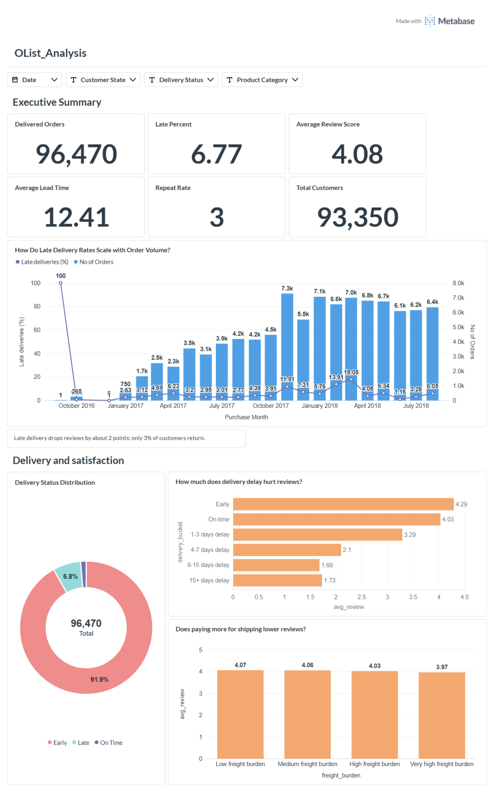

# Olist: How Delivery Performance Drives Customer Satisfaction and Repeat Purchase

A SQL (PostgreSQL) and Metabase analysis of ~96,000 delivered orders from the
[Olist Brazilian E-Commerce dataset](https://www.kaggle.com/datasets/olistbr/brazilian-ecommerce).
The project is hypothesis-driven: five hypotheses, ten SQL questions, one dashboard.



## Central question

How do delivery performance and other transaction factors affect customer
satisfaction and the likelihood of repeat purchase?

## Headline findings

- **Late delivery is the dominant driver of bad reviews.** Late orders average
  **2.27 / 5** vs **4.29** for early deliveries, a gap of about 2 points.
- **The penalty is steepest in the first week.** Reviews fall from 4.03 (on time)
  to 3.29 (1-3 days late) and 2.10 (4-7 days late), then flatten around 1.7.
- **Freight cost barely matters.** From the lowest to the highest freight burden,
  the average review only moves 4.07 to 3.97 (about 0.1 points).
- **Lateness is geographically concentrated.** Alagoas (AL, ~21%), Maranhao
  (MA, ~17-18%) and Sergipe (SE, ~15-16%) have the highest late rates, versus
  ~4.5% in Sao Paulo. Platform-wide, 6.8% of orders arrive late.
- **Repeat purchase is rare: 3.0%** of customers (2,801) placed more than one
  delivered order. First-order reviews are nearly identical for repeat (4.20) and
  one-time customers (4.15), so first-order satisfaction does not explain who returns.
- **Some categories are bad even when delivery is fair.** Men's fashion, office
  furniture and landline telephony have roughly 5-8% late rates but 19-26% poor
  (1-2 star) reviews, so fixing logistics alone would not fix them.
- **Problem sellers exist but are a minority.** Among sellers with 30+ orders,
  the worst has 32.6% of orders late.

## Hypotheses

| # | Hypothesis | Verdict | Evidence |
|---|-----------|---------|----------|
| H1 | Late deliveries are associated with lower review scores | **Strongly supported** | 2.27 vs 4.29 (Q4); steep drop by days late (Q5) |
| H2 | Lower first-order review scores are associated with lower repeat purchase | **Not supported** | First review 4.20 (repeat) vs 4.15 (one-time) (Q8) |
| H3 | Higher freight burden is associated with lower review scores | **Weak effect** | ~0.1 point range across burden levels (Q6) |
| H4 | Certain sellers/categories have disproportionately poor delivery performance | **Supported** | Seller late rates up to ~33% vs 6.8% platform; category patterns (Q9, Q10) |
| H5 | First-order delivery experience differs between repeat and one-time customers | **Modest difference** | First order late: 5.7% (repeat) vs 6.8% (one-time) (Q8) |

## Dashboard

The Metabase dashboard (`OList_Analysis`) has three sections: executive summary,
delivery and satisfaction, and seller and category. The full export is in
[`metabase/OList_Analysis.pdf`](metabase/OList_Analysis.pdf).

| Section | Screenshot |
|---|---|
| Executive summary + delivery and satisfaction | [01_overview_and_delivery.png](metabase/screenshots/01_overview_and_delivery.png) |
| Late rates by state + sellers needing intervention | [02_states_and_sellers.png](metabase/screenshots/02_states_and_sellers.png) |
| Category reviews + "are bad reviews caused by delivery only?" | [03_categories.png](metabase/screenshots/03_categories.png) |

## Repository structure

```
olist-delivery-customer-satisfaction/
├── README.md
├── sql/
│   ├── 01_views.sql                 order_analysis, customer_analysis, seller_analysis
│   ├── 02_delivery_performance.sql  Q1-Q3: status split, lead time, late rate by state
│   ├── 03_delivery_vs_reviews.sql   Q4-Q6: delay vs reviews, freight burden  (H1, H3)
│   ├── 04_repeat_purchase.sql       Q7-Q8: repeat rate, first-order experience  (H2, H5)
│   └── 05_sellers_categories.sql    Q9-Q10: seller and category problems  (H4)
├── metabase/
│   ├── OList_Analysis.pdf
│   └── screenshots/
```

## Data notes

- **`customer_id` vs `customer_unique_id`.** Olist generates a new `customer_id`
  for every order, so counting it just counts orders. All repeat-behaviour
  analysis uses `customer_unique_id`, which identifies a real person across orders.
- **Delivery status** compares the actual delivery date with the estimated date at
  day granularity. About 92% of orders arrive "early", which is consistent with
  conservative delivery estimates.
- **Seller analysis** is limited to sellers with 30+ orders. The seller base is
  heavily skewed (median 6 orders, mean ~32), and all 31 sellers averaging more
  than 10 days late have fewer than 10 orders, so ranking small sellers would mostly
  rank noise.
- **A data-quality fix.** An early version of the customer view also grouped by
  city, which split customers who moved into several rows. Correcting it to group by
  `customer_unique_id` alone moved the repeat rate from 2.89% to 3.00%. The
  conclusions did not change.

## Limitations

- **Association, not causation.** Late orders may also differ in category, region
  or seller quality; no controls were applied.
- **Repeat purchase has low power.** Only 3% of customers return within the roughly
  two-year window, so small gaps (e.g. 4.20 vs 4.15) should be read as directional.
  No significance tests were run.
- **Reviews are voluntary**, so there may be response bias.

## How to reproduce

1. Download the dataset from
   [Kaggle](https://www.kaggle.com/datasets/olistbr/brazilian-ecommerce) and load the
   CSVs into PostgreSQL as tables named `orders`, `customers`, `order_items`,
   `order_reviews`, `sellers` and `products`. The raw data is not included in this
   repo; check the dataset page for its license terms.
2. Run `sql/01_views.sql`, then the numbered files in order.
3. (Optional) Connect Metabase to the database and rebuild the dashboard cards from
   the queries. The dashboard filters (date, customer state, delivery status,
   product category) are Metabase dashboard filters.

## Tools

· PostgreSQL pgAdmin · Metabase
